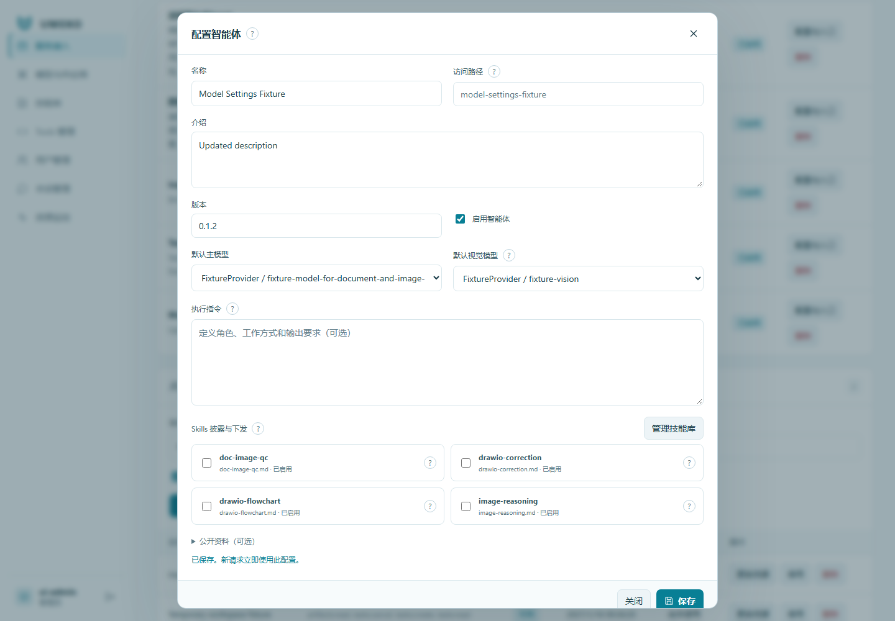

# 智能体与服务接入

推荐使用本地 Agent 协助日常管理，尤其适合同时调整介绍、工作指引、默认模型和技能范围，或在发布后检查 MCP/A2A 接入。先在管理入口点击“使用AI来配置”，把提示词或完整 Skill.zip 交给本地 Agent，再说明本次目标。操作流程与任务示例见[本地 Agent 管理指南](local-agent.md)；以下介绍控制台中的字段和入口，便于核对结果。



## 创建或配置智能体

在“服务接入”的智能体管理区域新建或编辑，维护以下关键项：

| 字段 | 如何使用 |
| --- | --- |
| 名称、介绍 | 向使用者说明擅长的任务和输入要求 |
| 访问路径名 | 稳定的 `slug`，成为 `/agent/<slug>/...` 的一部分 |
| 工作指引 | 对执行 Agent 生效，不在公开 Agent Card 中全文披露 |
| 默认主模型、默认视觉模型 | 当前智能体使用的模型基准 |
| Skill 披露 | 选择当前智能体获准使用并公开简介的技能 |
| 启用 | 停用后不再接受该智能体的新调用 |

Agent Card 的 Skills 来自该智能体选择、启用且可解析的技能简介。它是能力介绍，不是完整技能正文，也不是独立的 MCP 工具集合。

## 自带的检查智能体

| 智能体 | 访问路径 | 检查内容 |
| --- | --- | --- |
| 图像质检 | image-qc | 图片质量、图文一致性和界面截图，输出 HTML/JSON/ZIP 报告 |
| 文档检查 | document-check | 错字、术语、参数、步骤、前后矛盾与文中网址，直接给结论和修改建议 |
| 超链接检查 | hyperlink-check | 链接失效、目标文档/章节缺失和外部访问限制，逐条提供证据与建议 |

图像质检的界面项包含输入输出流程、默认值、高危操作提示和必选参数星号。请附上参数解释或相关操作说明；缺少依据时标未验证，不靠字段名猜必选，也不把截图里的已填值当成默认值。原图体积、宽高和总像素由报告脚本实测；默认超过 5 MiB、最长边 4096 像素或 1600 万像素给提醒。用户有专门标准时，可让 Agent 在报告 JSON 的 image_limits 中设置 max_bytes/max_edge/max_pixels。清晰度另按实际文字、细节及用途判断，原图不会被脚本修改。

文档检查使用 document-check 技能与现有 download_url。上传可读取的 UTF-8 文本文档，或直接提供正文及参考材料；工具不能提取的 PDF/Word 等会说明限制并请求可读文本。报告区分明确错误、建议和待确认，保留位置与原文；不自动改写源文档。

网址既检查是否能取得，也核对页面内容是否符合正文说明；HTTP 200 不代表指向正确。需要登录、内网白名单、证书、DNS、超时或大小限制会记录为受限/未验证。由管理员配置企业 CA 与允许的内网主机，不要求调用 Agent 关闭校验或绕过限制。正常完成直接拿到结果，不需要跳转工作台。

升级只替换识别出的原版技能与清单，保留管理员自定义内容和删除操作。新建的文档检查可在服务接入中编辑或停用；已有同路径的自定义智能体不被覆盖。图片报告脚本更新后，在[技能库可信代码](skills.md)审核当前版本，再用新会话/新任务使用新版；已有会话保持旧副本，不会重新签名。

## 使用超链接检查

在“服务接入”中选择“超链接检查”，访问路径为 `hyperlink-check`。提交网址清单或含链接的可读取文档，尽量附上期望的手册名、文档编号、产品版本和章节。它只下发同名检查技能，不需要批准新的 Python 脚本；管理员可以编辑工作指引、选择主模型或停用它。升级保留已有同路径的自定义智能体和管理员修改。

检查分别回答三件事：网址能否打开、目标资源是否存在、没有公司内网/账号/特殊授权的外部使用者能否访问。下架提示页即使返回 HTTP 200 也会检查；跳到书架不等于找到了手册，手册存在也不等于目标章节存在。公司内部知识库、学习站点等即使服务器可以访问，也需要根据内部专用的实际证据提示外部限制。

网页工具返回标题和静态正文，不执行 JavaScript、不使用浏览器登录态。目录和锚点可继续读取原始 HTML；动态页面、截断正文、无法读取的文档或不明的目标均标“待核实”，不会直接判为不存在。服务器匿名请求成功也不等于已经从外网验证。企业 CA 和内网主机白名单沿用平台下载设置，检查任务不会自动放宽它们。

结果直接返回问题、位置、实际响应/内容证据及建议，长清单可附报告文件。可这样提交：

```text
请检查以下链接，受众是没有公司账号的外部使用者：
https://docs.example.test/books — 期望找到《设备配置手册》2.0
https://docs.example.test/manual#network — 期望是该手册的“网络配置”章节
请分别核对链接失效、目标资源缺失和访问限制，不确定的标记待核实。
```

## 查看真实接口

配置弹窗的标签页可以查看 Agent Card、MCP 工具和提示词披露、请求参数及原始 JSON。`tools/list` 是向 MCP 地址发送的协议方法，不是在地址后追加 `/tools/list`。

用户服务基址为 `https://agents.example.internal/workbench`、路径名为 `reviewer` 时：

```text
https://agents.example.internal/workbench/agent/reviewer/.well-known/agent-card.json
https://agents.example.internal/workbench/agent/reviewer/mcp
https://agents.example.internal/workbench/agent/reviewer/a2a
https://agents.example.internal/workbench/agent/reviewer/v1/tasks
```

若入口旁出现未配置 `UMEKO_PUBLIC_URL` 的提示，应由部署管理员填写用户服务的外部完整地址。不能把容器中的环回地址交给外部同事，也不能把管理端前缀混进机器地址。

## 接入方式与服务账号

需要凭据时，为接入方建立服务账号、选择 scope 并签发凭据。服务账号用于机器调用的数据归属和权限，不要求对方创建网页登录账号；凭据遗失后换新，平台不会长期展示旧的明文凭据。

免鉴权模式可以省略服务凭据，但同一智能体下的免凭据调用共用身份、任务可见范围和账号额度。IP 只帮助后台观察来源，不用于鉴权或数据隔离。带无效凭据的请求不会自动退回免鉴权。

停用凭据会阻止后续请求；停止已接受的任务需要在资源监控中取消。删除账号前先处理未结束任务，按界面反馈确认关联历史的清理范围。
