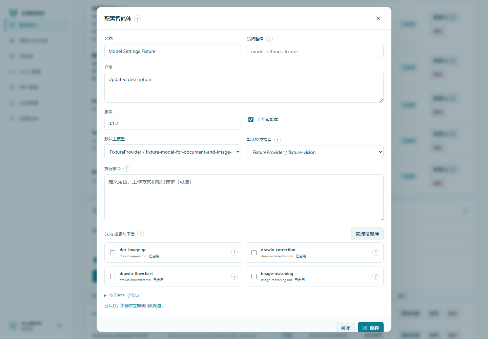

# 智能体与服务接入



## 创建或配置智能体

在“服务接入”的智能体管理区域新建或编辑，维护以下关键项：

| 字段 | 如何使用 |
| --- | --- |
| 名称、介绍 | 向使用者说明擅长的任务和输入要求 |
| 访问路径名 | 稳定的 `slug`，成为 `/agent/<slug>/...` 的一部分 |
| 工作指引 | 对执行 Agent 生效，不在公开 Agent Card 中全文披露 |
| 默认主模型、默认视觉模型 | 当前智能体使用的模型基准 |
| Skill 披露 | 选择当前智能体获准使用并公开简介的技能 |
| 启用 | 停用后不再接受该智能体的新调用 |

Agent Card 的 Skills 来自该智能体选择、启用且可解析的技能简介。它是能力介绍，不是完整技能正文，也不是独立的 MCP 工具集合。

## 查看真实接口

配置弹窗的标签页可以查看 Agent Card、MCP 工具和提示词披露、请求参数及原始 JSON。`tools/list` 是向 MCP 地址发送的协议方法，不是在地址后追加 `/tools/list`。

用户服务基址为 `https://agents.example.internal/workbench`、路径名为 `reviewer` 时：

```text
https://agents.example.internal/workbench/agent/reviewer/.well-known/agent-card.json
https://agents.example.internal/workbench/agent/reviewer/mcp
https://agents.example.internal/workbench/agent/reviewer/a2a
https://agents.example.internal/workbench/agent/reviewer/v1/tasks
```

若入口旁出现未配置 `UMEKO_PUBLIC_URL` 的提示，应由部署管理员填写用户服务的外部完整地址。不能把容器中的环回地址交给外部同事，也不能把管理端前缀混进机器地址。

## 接入方式与服务账号

需要凭据时，为接入方建立服务账号、选择 scope 并签发凭据。服务账号用于机器调用的数据归属和权限，不要求对方创建网页登录账号；凭据遗失后换新，平台不会长期展示旧的明文凭据。

免鉴权模式可以省略服务凭据，但同一智能体下的免凭据调用共用身份、任务可见范围和账号额度。IP 只帮助后台观察来源，不用于鉴权或数据隔离。带无效凭据的请求不会自动退回免鉴权。

停用凭据会阻止后续请求；停止已接受的任务需要在资源监控中取消。删除账号前先处理未结束任务，按界面反馈确认关联历史的清理范围。
