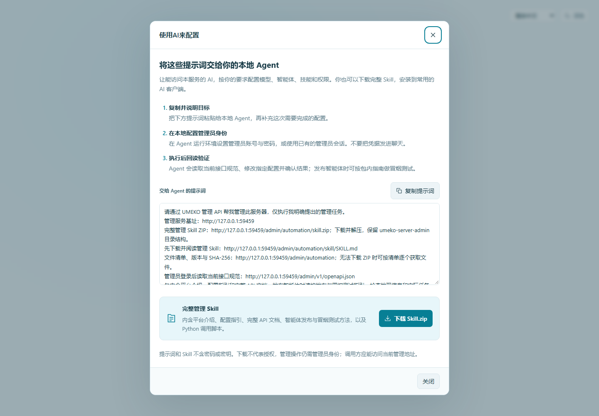

# 用 AI 和 API 管理服务器

管理员可以在管理登录页或控制台顶部点击 **使用AI来配置**。弹窗说明如何将提示词交给本地 Agent，提供提示词预览、**复制提示词**和 **下载 Skill.zip**。提示词包含当前管理服务的真实外部地址、Skill 下载地址和接口规范地址，不包含密码、Cookie 或模型密钥。

对于智能体的日常配置与发布，推荐将这套管理 Skill 交给本地 Agent 使用。它可以连贯完成读取配置、定向修改、保存回读和接入验收；具体场景与可复制的任务示例见[使用本地 Agent 管理智能体](local-agent.md)。本页说明接入、身份和 API 调用方式。



## 从复制到实际操作

1. 打开公司提供的管理入口，点击“使用AI来配置”，把弹窗内的提示词交给能访问本服务、具备 HTTP 请求或本地脚本能力的 AI。
2. AI 下载并解压完整 Skill.zip，保留目录层级；也可自己点击下载，把解压后的目录安装到支持技能的本地 Agent。无法下载 ZIP 时仍可按文件清单逐个取得文件。
3. 在同事自己的电脑或 AI 运行环境中配置管理员身份。AI 用账号登录管理 API，取得本次登录 Cookie，再读取当前版本的接口规范。
4. 给出具体任务，例如“把资料处理模型的并发限制设为 2，并回读确认”或“查看失败任务的工具记录”。AI 只处理明确授权的目标。
5. AI 读取状态、按接口修改并回读。涉及删除、开放权限、批准代码等操作时，先明确范围与影响；已有明确授权不需要重复确认。

复制提示词不会自动授权、创建管理员账号或开放管理端口。同事仍需具备管理员身份；机器业务调用凭据不能用于管理服务器。

## Skill 的形式

服务提供标准 Agent Skills 目录：

```text
umeko-server-admin/
  SKILL.md
  scripts/admin_api.py
  references/
    platform.md
    configuration.md
    agent-publishing.md
    api.md
    api-reference.md
    schemas.md
    openapi-admin.json
```

`SKILL.md` 说明接入与按需阅读顺序。ZIP 包含平台介绍、逐步配置指引、智能体发布、REST/MCP/A2A 冒烟测试、完整管理 API 参考和数据结构、OpenAPI 快照。Python 脚本提供 Cookie 登录、通用 JSON 请求、错误处理与输出脱敏，Python 3.10+ 即可运行，无第三方包；业务协议测试按指南安装相应客户端。

发布检查先验证 Card、MCP 工具披露等不调用模型的步骤；用户要求实际验收时，再提交符合该智能体输入要求的合成任务，检查终态、业务结果与产物。文档区分本机、测试代理与真实外部入口，不把提交成功当作完成。

这是供外部管理者下载的 Skill，不会自动加入普通用户的技能库，也不在服务器上代替管理员执行脚本。不会修改旧会话副本或自动批准代码。

## 管理基址与端口

管理 API 默认与管理页面一起监听 **9000**，沿用同一 Cookie 鉴权；没有新增第三个端口。用户工作台与 REST/MCP/A2A 默认是 **8000**。生产中的域名、端口和路径以管理员发布的入口为准。

例如管理基址为 `https://admin.example.internal/operations/console`：

| 地址 | 用途与鉴权 |
| --- | --- |
| `<管理基址>/admin/automation` | 公开的 Skill 文件清单、版本、大小和 SHA-256 |
| `<管理基址>/admin/automation/skill.zip` | 完整 `umeko-server-admin.zip`，含说明、脚本和全部参考 |
| `<管理基址>/admin/automation/skill/SKILL.md` | 公开的 Skill 主指引；仅说明，不含凭据 |
| `<管理基址>/admin/automation/skill/references/api.md` | 操作行为参考 |
| `<管理基址>/admin/automation/skill/scripts/admin_api.py` | 可下载到同事本地的调用脚本 |
| `<管理基址>/admin/login` | 管理员账号密码登录 |
| `<管理基址>/admin/v1/me` | 验证当前管理员，需要管理员 Cookie |
| `<管理基址>/admin/v1/openapi.json` | 运行版本的接口规范，需要管理员 Cookie |
| `<管理基址>/admin/logout` | 撤销当前管理登录会话 |

地址使用 `UMEKO_ADMIN_BASE_PATH`，不读取用户服务的 `UMEKO_PUBLIC_URL` 或 Provider 的 `base_url`。复制按钮使用浏览器实际访问的 origin 和服务端注入的管理前缀，适配反向代理外部域名，不从当前页面路径猜前缀。

ZIP 随版本预先构建，服务只返回文件，下载不需要在生产机器临时打包，也不要求同事安装 Python 后才能下载。原始文件清单还包括全部参考文档，可按 SHA-256 校验。

## 本地调用脚本

调用者配置自己的本地环境变量，这些不是服务器启动配置：

| 变量 | 用途 |
| --- | --- |
| `UMEKO_ADMIN_URL` | 完整管理基址，包含管理前缀 |
| `UMEKO_ADMIN_USERNAME` / `UMEKO_ADMIN_PASSWORD` | 已有管理员身份，只在本地配置，不贴进聊天 |
| `UMEKO_ADMIN_CA_FILE` | 可选，追加企业 CA 的 PEM 文件，保持证书和主机名校验 |
| `UMEKO_ADMIN_PROXY` | 可选，调用者显式指定的 HTTP/HTTPS 代理 |

```sh
python scripts/admin_api.py GET /admin/v1/me
python scripts/admin_api.py GET /admin/v1/openapi.json --output admin-openapi.json
python scripts/admin_api.py GET /admin/v1/providers
python scripts/admin_api.py PUT /admin/v1/models/<实际模型ID> --json-file change.json
```

`change.json` 可以是 `{"max_concurrent_requests":2}`。基址已含前缀，命令路径保持 `/admin/...`。脚本在一个进程内登录、复用会话并退出，不持久化 Cookie，不自动重试请求。也可在 Python 工程中导入 `AdminClient`，在一个 `with` 块中执行多个 API 操作。

默认输出会遮蔽密码、模型 Key 和 Token；`--output` 保存的也是脱敏 JSON。需要保留只返回一次的服务凭据时，传 `--secrets-output <调用者指定的新文件>`，脚本先确认该路径可创建再执行操作；不要把完整响应贴回对话。POSIX 新文件权限为 0600，其他系统应使用受限目录。

## 能管理什么

所有管理页面的服务端能力都有 HTTP 接口：用户与角色、用户模型/工具权限、Provider 与模型、每模型并发、默认模型、工具回合上限、智能体与技能范围、服务接入、服务账号、技能文件与下发、可信代码、脚本测试、会话内容、机器任务和资源监控。

完整方法、字段约束、状态码和操作行为见 [管理接口完整参考](api-reference.md) 与 [请求数据结构](schemas.md)。[下载规范快照](openapi-admin.json)用于离线阅读；实际执行前优先读取运行服务的规范。

主题与界面语言是浏览器偏好；监听端口、TLS 和路径前缀是启动配置，不能当作管理 API 可热改的服务配置。

## 几个容易误操作的地方

- `toggle` 会反转状态，重试可能把刚启用的技能又关闭。先读取，再按目标决定是否调用。
- 创建账号、轮换凭据和导入不是可以盲目重放的操作。请求超时后先回读。
- 技能库文件、下发记录和旧会话副本分开管理。写入代码不会自动可信；批准只针对审核过的明确 SHA-256。
- 批量信任接口的 HTTP 200 不表示每项成功；逐项读取结果。409 时重新核对版本，不直接替换摘要继续批准。
- 删除用户、会话或服务账号会清理数据。驱逐缓存保留历史；取消任务需再观察终态。
- Provider 查询可返回完整密钥。用脚本默认脱敏，或按调用者授权保存到受限文件。

管理员的所有读写都继续经过原有身份检查、目录约束和技能安全门禁。下载说明不等于获得管理权限。
