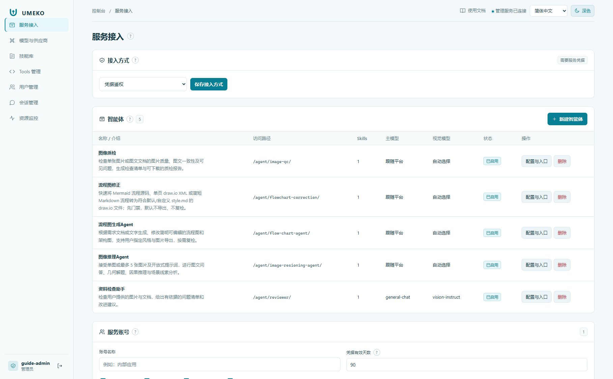

# 管理员配置顺序

使用管理员提供的管理入口登录；管理端与用户工作台可能位于不同端口或不同路径。

图中左侧是管理导航，右上可切换语言与明暗主题。每个标题附近的问号提供简短说明，悬浮或聚焦可查看。

## 首次配置建议顺序

1. 在[模型与供应商](models.md)新增 Provider 和模型，配置默认主模型、子模型及视觉模型，验证上游能够访问。
2. 在[技能库](skills.md)维护要下发的技能，审核代码与配置后批准可信版本。
3. 在[服务接入](agents.md)配置智能体的介绍、工作指引、默认模型和技能披露范围。
4. 选择服务接入方式：需要凭据，或按实际协作范围开启免鉴权。复制当前智能体的真实调用入口。
5. 在[Tools 与用户权限](permissions.md)中检查允许使用的能力，再用一个合成材料执行测试任务。
6. 到[资源监控](monitoring.md)查看排队、上下文、工具返回、最终结果和会话文件树，确认整条链路正常。

## 导航速查

| 页面 | 主要操作 |
| --- | --- |
| 服务接入 | 智能体、协议披露、服务账号与凭据 |
| 模型与供应商 | 上游连接、模型能力、默认模型、模型并发 |
| 技能库 | 技能文件树、下发、Python/config 的信任审批与撤销 |
| Tools 管理 | 按分类搜索工具、全局下发设置 |
| 用户管理 | 用户权限与会话入口 |
| 会话管理 | 查询用户会话、查看消息与工具记录 |
| 资源监控 | 机器资源、模型队列、机器任务详情与取消 |

管理操作应按当前版本的界面反馈确认成功。修改模型或技能后，使用新任务验证；不要仅凭首页能打开就认定部署完成。

需要让自己的 AI 代为配置时，在管理登录页或控制台顶部点击“使用AI来配置”，在弹窗中复制提示词或下载完整 Skill.zip。完整流程及全部接口见 [AI 与 API 管理](automation.md)；复制内容不含密码，操作仍需管理员身份。
