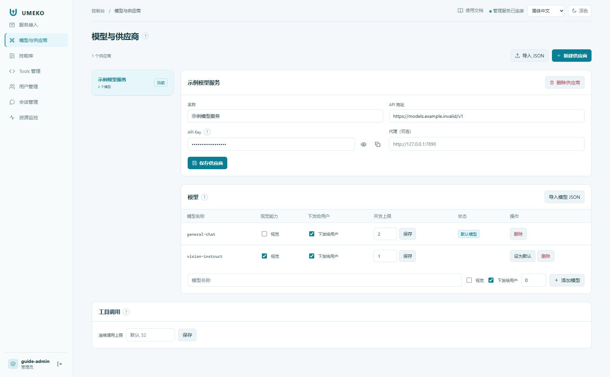

# 模型与供应商

## Provider 与 Model 的区别

Provider 保存上游服务的连接信息，例如 API 地址和密钥；Model 表示这个服务上的具体模型和能力。Provider 的 `base_url` 是**模型接口地址**，不是 UMEKO 的网页地址，也不是 NGINX 的路径前缀。

1. 新增 Provider，填写管理员掌握的接口地址及访问密钥。
2. 新增或同步模型，确认上游模型标识与实际服务匹配。
3. 按实际能力设置视觉标记，并验证工具调用兼容性；不把纯文本模型标记为视觉模型。
4. 设置默认主模型、子模型及视觉模型。智能体还可以选择自己的默认主模型和默认视觉模型。
5. 保存后以新任务验证；普通聊天成功不代表视觉调用和工具调用也成功。

## 每模型并发

| 值 | 含义 |
| --- | --- |
| `0` | 平台不设置该模型的并发上限 |
| 正整数 | 同时使用该模型的请求最多为此数量，其他请求排队 |

该限制跨网页、机器任务、子 Agent 与视觉工具共享。它不是上游 LiteLLM 或其他网关的 RPM/TPM 保证；其他系统也可能同时消耗上游额度。排查时同时查看任务队列、模型队列和上游返回。

## 内网 HTTPS 与工具兼容

模型服务使用企业证书时，由部署管理员配置可信 CA；模型 HTTPS 与文件下载 HTTPS 是不同的连接配置。不要把证书失败当成模型无能力。

部分上游只在带工具的请求中报 `auto tool choice` 不支持。本平台在识别到对应的 400 后才启用兼容回退；不会默认关闭工具能力。若仍失败，在机器任务详情中查看模型错误和该轮上下文，再核对 Provider 的实际配置。

!!! note "密钥的边界"
    调用 UMEKO 的服务凭据与 Provider 模型密钥分开。向接入方提供服务地址和约定的服务凭据，不提供上游模型密钥。截图和工单也不要包含密钥。
