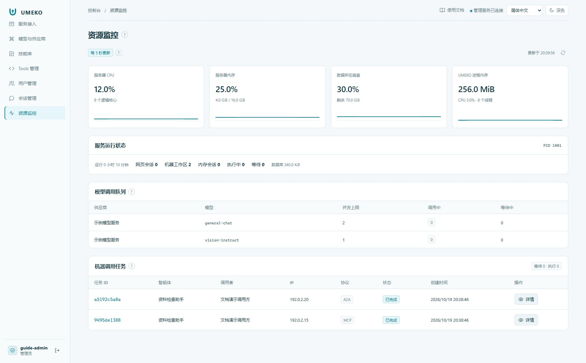
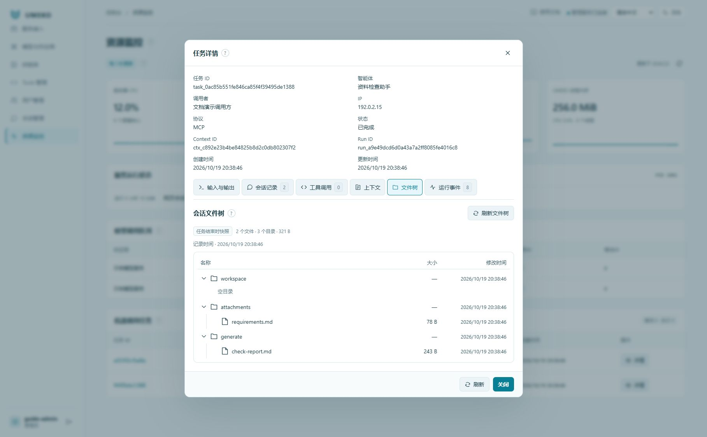

# 资源监控与排查

## 先判断卡在哪一层

| 看到的情况 | 建议查看 |
| --- | --- |
| Task 一直 queued | 任务 Worker、任务队列和调用者额度 |
| Task 已 running，但模型在等待 | 对应模型的当前并发和等待队列 |
| 模型已经回复错误 | Provider 上游返回、证书、工具兼容和模型能力 |
| 工具反复失败 | 工具参数、实际返回、缺失材料或技能信任状态 |
| 临时工作台或文件不见了 | 节点是否过期，调用记录是否仍在保留期内 |

## 点开机器任务详情

点击机器调用任务记录，查看来源协议、状态、调用者与来源 IP、输入输出、执行上下文和工具调用过程。不要把来源 IP 当作账号或鉴权依据。

文件树标签显示附件、工作目录和生成目录的名称、结构、类型和大小等元数据。节点文件被清理后，保留期内仍可查看保存的快照；它不是完整文件备份，也不保证能重新打开原文件内容。

## 停止与故障复盘

需要停止长任务时使用取消操作，再观察状态是否成为 `cancelled`。取消是协作式的，不能把“已请求取消”等同于每个子进程已经退出。

Agent 因关键材料不可得而提交情况说明时，Task 可以是 `completed`，但文本会说明没有完成业务检查。复盘必须同时看结果文字、产物和工具返回，不能仅把 completed 当作检查通过。

导出日志或截图求助前，去除模型密钥、服务凭据、用户文件内容和临时工作台的完整能力链接。
