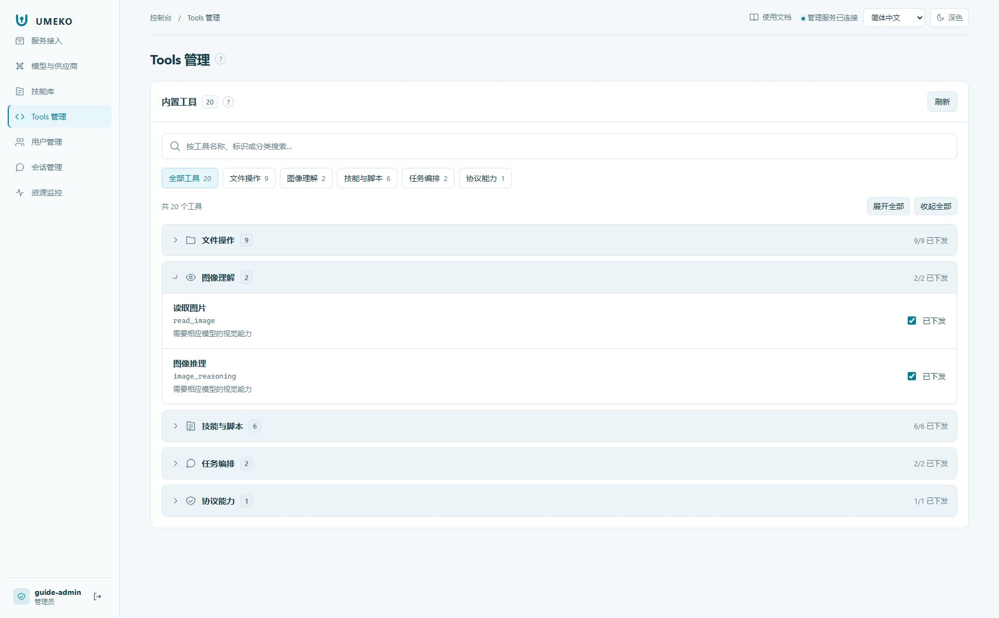

# Tools 与用户权限

Tools 是 Agent 可以调用的内置能力，例如文件操作、下载、图像推理、技能加载与脚本执行；它们与技能正文不同。一个工具被显示在列表里，也不表示每个用户都拥有执行权限。

## 全局设置

1. 进入 Tools 管理，按分类浏览或搜索工具名、用途。
2. 展开需要调整的分类，核对工具说明。
3. 修改全局下发状态并确认保存成功。
4. 以目标用户的新请求验证实际可用能力。

## 单独授权

在用户管理中查看用户的工具权限。全局未下发的工具可以按需单独授予用户；用户专有授权与全局默认不是同一开关。模型和 Provider 也有各自的开放范围，不要把工具授权当成模型授权。

普通用户仍只能在自己的安全目录范围内处理文件。允许 `file_operate` 或 `download_url` 不会自动开放服务器任意目录，也不会撤销技能代码保护。

## 用户与会话

从用户进入会话列表后，可以返回用户列表；管理员可查看会话对话和工具记录。排查时先确认用户、会话和运行，而不是仅凭相同的文件名判断是否属于同一次任务。
