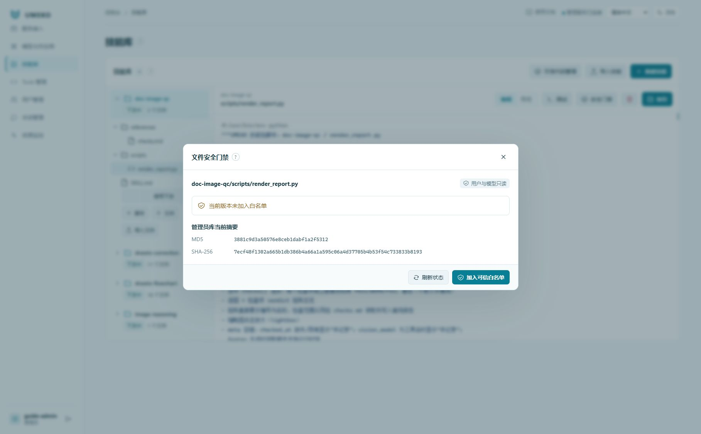
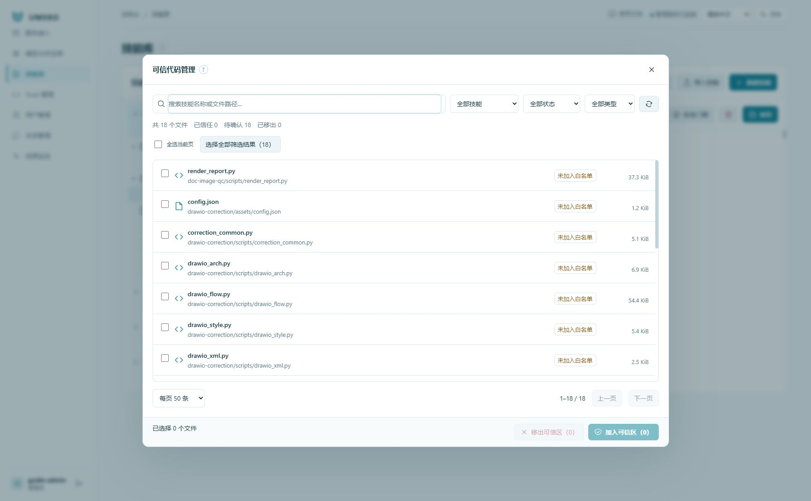

# 技能与可信代码

技能以目录管理，主入口是 `SKILL.md`，可以包含 `scripts/`、`references/`、`assets/` 等。先在管理员技能库维护和审核，再下发到新会话。用户会话拿到的是独立副本。

## 批准当前版本

1. 在技能库文件树中选中 Python、`config.json` 或其他受保护文件。
2. 查看安全门禁中显示的当前摘要、批准状态和版本是否一致。
3. 审核文件内容及用途后，将该文件的**当前版本**加入可信区域。
4. 需要处理多个文件时，进入整库可信代码管理，搜索、筛选并多选；确认选中的文件及当前版本，再执行批量批准。
5. 新建会话或提交新机器任务验证执行结果。

## 状态为什么会变化

| 情况 | 应怎么处理 |
| --- | --- |
| 未批准 | 审核管理员库中的文件，批准当前版本 |
| 文件变更、摘要不匹配 | 对比变更后重新审核，不能跳过摘要检查 |
| 已移出可信区 | 确认撤销原因；旧会话此前获得的授权也可能被拦截 |
| 新版已批准，旧会话仍失败 | 旧副本不会被重新签名，使用新会话获取新版 |

执行前会核对固定位置、管理员白名单、MD5 和 SHA-256，并检查包内辅助代码与配置。脚本通过门禁表示版本获准执行，不代表任意脚本已经被沙箱化。

## 升级后检查

升级程序和技能后先查看库文件是否发生改变，再审核所需版本并用新会话验证。不要删除信任记录、关闭校验或把不匹配文件自动当作可信。用户技能副本中的 Python、配置及相关受保护文件只读，上传、移动、复制、重命名和解压也不能绕过保护。
