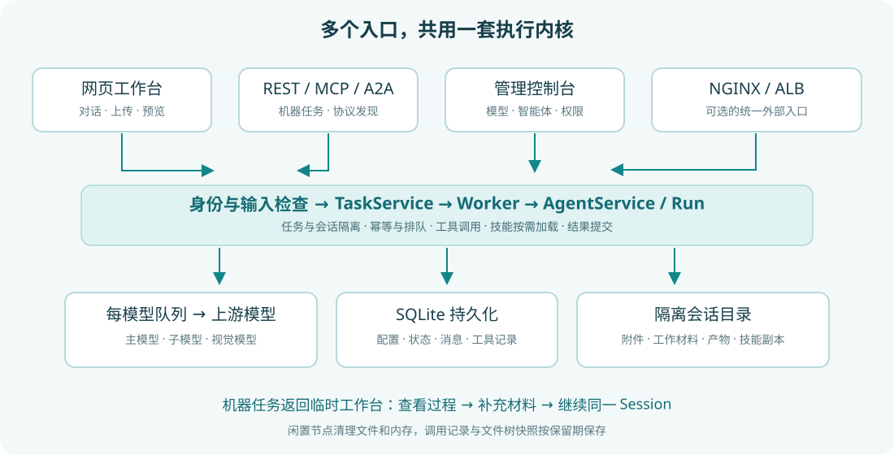

# 软件架构

UMEKO 是共享执行内核上的多个入口：人通过网页工作台交互，程序通过 REST、MCP、A2A 调用。它们最终使用同一套 Agent、工具、技能和模型配置。

## 从一次请求看各部分的作用

1. 浏览器或客户端访问管理员公布的域名和路径。NGINX、ALB 等入口可以转发到实际服务端口；前缀由平台运行时配置，调用方应使用完整地址。
2. 网页请求检查用户登录；机器请求采用服务凭据或管理员开启的免鉴权模式。两者不会把 Provider 的模型密钥交给使用者。
3. 机器提交先检查参数、幂等键和队列容量，通过后保存 Task。提交回执不等于模型已经执行完毕。
4. Worker 为任务创建隔离会话，再由 Run 执行 Agent 循环。模型选择、工具和技能来自当前智能体配置的快照。
5. 每次模型调用进入对应模型的队列。模型可以调用文件工具、视觉工具或管理员批准的技能脚本，再继续推理。
6. 机器 Agent 用 `submit_results` 提交自然语言结果和实际交付文件清单；接入方再查询结果、下载文件。任务还可以通过临时工作台接续。

## 数据与边界

| 部分 | 保存什么 | 使用时应理解的边界 |
| --- | --- | --- |
| SQLite | 账号、配置、任务状态、会话消息、工具记录、文件元数据 | 状态查询不需要重新调用模型 |
| 会话目录 | 附件、工作文件、生成文件、技能副本 | 用户、会话与机器任务之间有访问边界 |
| 管理员技能库 | 待下发的技能文件和受信任版本 | 批准库文件不等于改写旧会话副本 |
| 每模型队列 | 正在使用与等待使用该模型的请求 | 主、子 Agent 和视觉调用共用该模型额度 |
| 临时节点 | 机器任务的可接续会话 | 活跃运行期间不回收；闲置后清理文件与内存 |

## 两层排队

任务队列控制这个服务同时执行多少机器任务；模型队列控制某个模型的调用并发。一个任务可以调用多个模型，因此这两个数字不是一回事。Provider 页面中的并发限制在**模型**粒度设置，`0` 表示不限制；上游仍可能有独立的请求数或 token 配额。

## 当前运行方式

当前采用单应用进程和持久化数据目录。模型额度与执行协调不是跨进程的分布式限流；不要仅靠增加应用进程数来扩容。重启会中断正在执行的任务，不会悄悄重放已经执行过的有副作用工具。排队、失败、取消和到期信息可在资源监控中排查。
