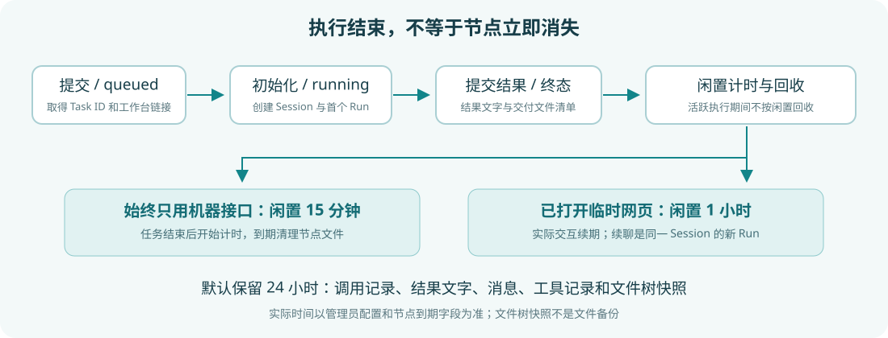

# 会话与节点生命周期

## 先区分四种 ID

| 标识 | 它表示什么 | 它不代表什么 |
| --- | --- | --- |
| Agent / slug | 稳定的服务配置与调用路径 | 不是某次执行 ID |
| Task ID | 一次机器提交的执行与结果记录 | 不是任意用户可访问的公开资源 |
| Session ID | 保存上下文和文件的会话 | 不等同于 A2A contextId |
| Run ID | 同一会话中的一轮提问 | 不是整个会话的生命周期 |

A2A 的 contextId 只给任务分组。反复创建新 Task，即使业务内容相似，也不会自然继承上次模型上下文。要继续原任务，应使用返回的临时工作台及其 Session。

## 机器任务状态

| 状态 | 意义 |
| --- | --- |
| queued | 输入已接收，等待任务 Worker |
| running | 已被调度；初始化、模型排队和执行都可能发生在此阶段 |
| cancelling | 已请求取消，等待协作式结束 |
| completed | 本轮已提交结果，不等同于业务检查通过 |
| failed | 本轮执行失败，查看 error 和工具记录 |
| cancelled | 本轮已取消 |

缺少必要图片时，Agent 可以通过提交情况说明完成本轮，所以 completed 不保证图片已经检查完成。结果中的 text、files 和限制说明必须一起阅读。

## 默认回收规则

| 对象 | 默认保留方式 |
| --- | --- |
| 纯机器节点的会话文件 | 原任务结束后闲置 15 分钟回收 |
| 已打开的临时工作台 | 按网页实际活动计时，闲置 1 小时回收 |
| 活跃的原任务或后续 Run | 活跃期间不按闲置规则回收，结束后重新计时 |
| 调用记录、结果文字、消息、工具记录与文件树快照 | 默认在任务结束后保留 24 小时 |
| 普通网页登录会话 | 按普通会话管理，不套用上述临时节点闲置规则 |

对应部署项为 `UMEKO_MACHINE_IDLE_SECONDS`、`UMEKO_TMP_IDLE_SECONDS`、`UMEKO_TASK_RETENTION_SECONDS`。管理员可以调整，具体到期时间以任务字段和临时工作台顶部显示为准。

点击、键盘输入、滚动、发送请求等实际交互会更新临时工作台活动；仅保持页面打开、心跳、SSE 和被动轮询不会无限续期。后台定期清理文件，节点一旦过期就不可再访问，磁盘释放可能稍后完成。

## 过期之后

浏览器显示“该节点已过期，请重新申请”。原 Task 在记录保留期内可能仍能查询结果文字与元数据，但文件下载和工作台不再可用。文件树快照不是文件备份。

重做需提交新任务，使用新的幂等键或 messageId。同一幂等键只会返回原有记录，不会复活节点。不要无限重试过期下载，也不要从 Task ID 猜造工作台随机地址。
